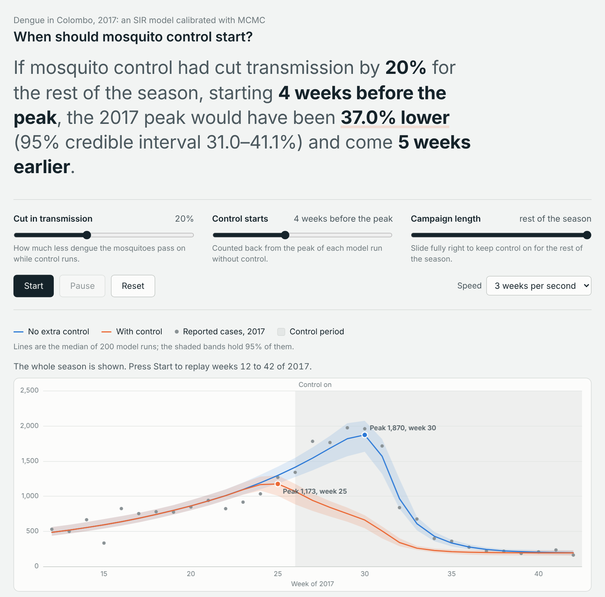
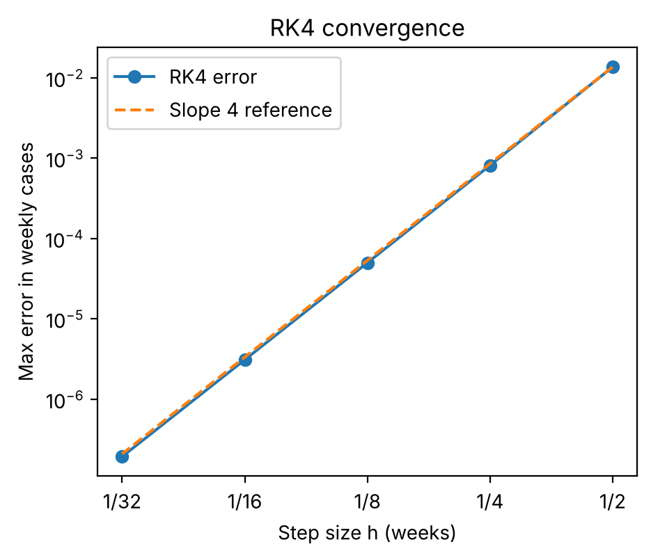
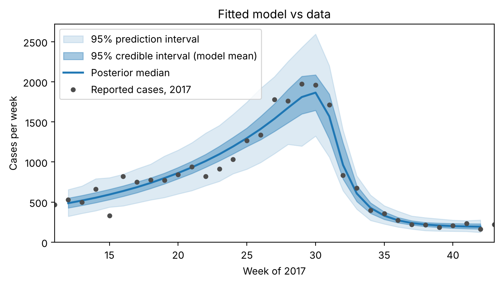
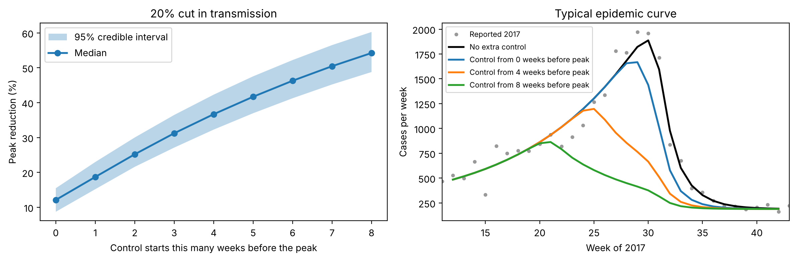
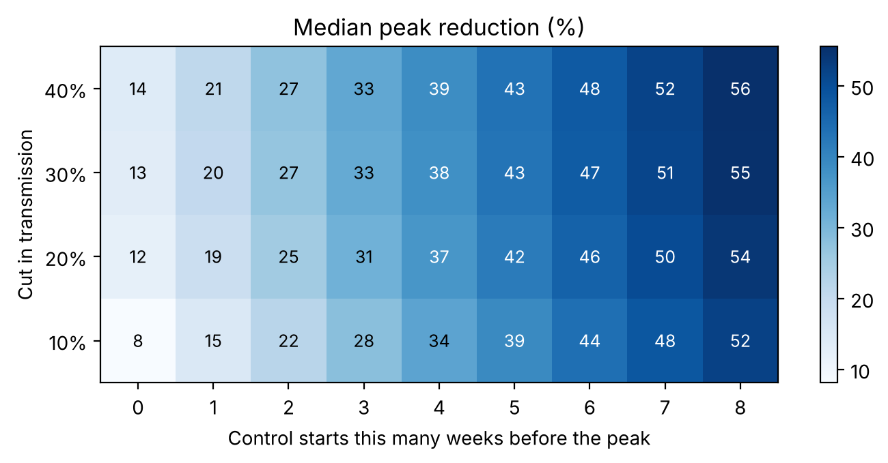

# When should mosquito control start? A dengue SIR model for Colombo, calibrated with MCMC

An SIR epidemic model, fitted to Colombo's 2017 dengue epidemic with a Metropolis MCMC sampler, that estimates how much lower and earlier the epidemic peak would have been if mosquito control had cut transmission earlier.

**[Live demo](https://geethsenaviratne.github.io/dengue-sir-mcmc-colombo/)** · [](https://colab.research.google.com/github/geethsenaviratne/dengue-sir-mcmc-colombo/blob/main/notebook/dengue-sir-mcmc-colombo.ipynb)



## The problem

In 2017, Colombo district had its largest dengue epidemic in the weekly records that begin in 2007. Reported cases rose from a few hundred a week early in the year to 1,972 in the week beginning 15 July. They then collapsed to below 300 a week by September. Mosquito-control campaigns are often launched once cases are already rising, so the timing of control is a decision health authorities face every dengue season.

This project asks one question: **if mosquito control had cut transmission by 20%, starting a given number of weeks before the peak, how much lower would the 2017 peak have been, and when would it have come?** The answer is given with 95% credible intervals, so the uncertainty in the fitted model is carried through to the result.

## Quick start

**Notebook:** click the *Open in Colab* badge above, then *Runtime → Run all*. Everything runs in under 8 minutes on a free runtime, and the data is downloaded from this repository automatically.

**Web demo:** open the [live demo](https://geethsenaviratne.github.io/dengue-sir-mcmc-colombo/), or download this repository and double-click `docs/index.html`. Nothing needs to be installed.

**Run locally (optional):**

```bash
pip install -r requirements.txt
jupyter notebook notebook/dengue-sir-mcmc-colombo.ipynb
```

## Using the demo

Three sliders set the scenario: how much control cuts transmission, how many weeks before the peak it starts, and how long it lasts. The chart shows the reported 2017 cases with the model with and without control, and the results give the peak reduction, peak timing and cases averted, each with a 95% credible interval. A check panel confirms that the default scenario matches the notebook. Full guide: [USER_GUIDE.md](USER_GUIDE.md).

## Model and mathematics

- **Model.** An SIR model of Colombo district (N = 2,480,000) in which the transmission rate β(t) drops once during the season through a smooth logistic switch. Mosquito control multiplies β(t) by (1 − c) while it runs. Expected weekly cases are the new infections in that week plus a constant background.
- **Solver.** A self-written, vectorised fourth-order Runge–Kutta (RK4) integrator, with h = 0.1 week for results and 0.25 week inside the sampler.
- **Calibration.** A negative-binomial likelihood for 31 weeks of cases (weeks 12–42) and uniform priors on six parameters, sampled with a random-walk Metropolis algorithm: 32 chains, a pilot run to tune the proposal, and the Gelman–Rubin R̂ to check convergence.
- **Scenarios.** Every result is a Monte Carlo estimate over 2,000 posterior draws, so each answer carries a 95% credible interval.

Full equations, assumptions and parameter values: [THEORY.md](THEORY.md).

## Verification

| Check | Result |
|---|---|
| PASS 1: S + I + R stays equal to N | Largest relative error 9.4 × 10⁻¹⁶ |
| PASS 2: analytic relation S = S₀ exp(−R₀R/N) for constant β | Largest relative error 1.0 × 10⁻⁹ |
| PASS 3: RK4 convergence order | Slope 4.03, expected 4 |
| PASS 4: limiting cases | R₀ < 1 dies out; a 0% cut equals the baseline |
| PASS 5: recovery of known parameters from synthetic data | All six true values inside their 95% credible intervals; R̂ ≤ 1.016 |
| Posterior predictive check on the 2017 data | 30 of 31 weeks (97%) inside the 95% prediction interval |

Each check is an `assert` in the notebook, so *Run all* stops if any of them fails.



## Concepts applied

This project applies compartmental (SIR) epidemic modelling and fourth-order Runge–Kutta integration of ordinary differential equations, with the solver's convergence order measured. It applies Bayesian calibration with a random-walk Metropolis Markov chain Monte Carlo sampler, and Monte Carlo posterior predictive simulation to put credible intervals on every scenario result. The solver is verified by a conservation check and a convergence-order test, and the calibration by recovering known parameters from synthetic data.

## Results

Before a drop in early August, transmission was only just above the epidemic threshold: R₀ = 1.096 (95% credible interval 1.080–1.114). The model fits the data well (figure below).



**Answer.** A 20% cut in transmission starting 4 weeks before the peak would have lowered Colombo's 2017 peak by **36.7% (95% CrI 32.3–42.3%)** and brought it about **5 weeks earlier**.

| Control starts | Peak reduction (95% CrI) | Peak shift | Cases averted, weeks 12–42 (95% CrI) |
|---|---|---|---|
| At the peak | 12.1% (8.7–15.5) | 1 week earlier | 9.0% (7.6–13.0) |
| **4 weeks before** | **36.7% (32.3–42.3)** | **5 weeks earlier** | **26.9% (24.3–32.1)** |
| 8 weeks before | 54.2% (48.8–60.3) | 9 weeks earlier | 43.9% (40.5–49.2) |

The peak comes earlier, not later: with R₀ so close to 1, a 20% cut stops the growth at once, so the highest week is the one just before control starts.



**Timing matters far more than strength.** Any sustained cut above the critical value c* = 1 − 1/R₀ = 8.8% (7.4–10.2%) stops the growth, so a weak 10% cut started 8 weeks early lowers the peak by about 52%, while a strong 40% cut started at the peak lowers it by only about 14%. The result hardly changes when the infectious period is refitted at 5, 6.5 or 8 days (37.3%, 36.8%, 36.6%).



## Limitations and future work

- **Hindsight.** Control is counted back from a peak that nobody knows in advance. A realistic trigger, such as three weeks of rising cases or a weather-based forecast, is the natural next test.
- **No mosquitoes, rainfall or serotypes.** The August drop is measured, not explained, and every scenario assumes it still happens. A rainfall-driven host–vector model would explain it.
- **Reporting.** Every infection is treated as a reported case, and reporting delays are not modelled.
- **One district, one season.** The numbers should not be applied directly to other years or places; fitting 2017–2019 and other districts would test whether the timing result holds.

## Repository contents

| Path | Contents |
|---|---|
| `notebook/dengue-sir-mcmc-colombo.ipynb` | The full model, calibration, verification and experiments |
| `docs/` | The web demo (plain HTML, CSS and JavaScript, no libraries), served by GitHub Pages |
| `data/` | The weekly case data, the script that rebuilds it, and its source and licence ([data/README.md](data/README.md)) |
| `figures/` | Figures produced by the notebook, and screenshots of the demo |
| [THEORY.md](THEORY.md) · [USER_GUIDE.md](USER_GUIDE.md) · [REFERENCES.md](REFERENCES.md) | Theory, demo guide and full reference list |

## Key references

1. W. O. Kermack and A. G. McKendrick, "A contribution to the mathematical theory of epidemics," *Proceedings of the Royal Society A*, vol. 115, pp. 700–721, 1927, doi: [10.1098/rspa.1927.0118](https://doi.org/10.1098/rspa.1927.0118).
2. H. A. Tissera *et al.*, "Severe dengue epidemic, Sri Lanka, 2017," *Emerging Infectious Diseases*, vol. 26, no. 4, pp. 682–691, 2020, doi: [10.3201/eid2604.190435](https://doi.org/10.3201/eid2604.190435).
3. M. Oki, T. Sunahara, M. Hashizume and T. Yamamoto, "Optimal timing of insecticide fogging to minimize dengue cases," *PLoS Neglected Tropical Diseases*, vol. 5, no. 10, art. no. e1367, 2011, doi: [10.1371/journal.pntd.0001367](https://doi.org/10.1371/journal.pntd.0001367).
4. N. Metropolis *et al.*, "Equation of state calculations by fast computing machines," *Journal of Chemical Physics*, vol. 21, no. 6, pp. 1087–1092, 1953, doi: [10.1063/1.1699114](https://doi.org/10.1063/1.1699114).
5. A. Gelman *et al.*, *Bayesian Data Analysis*, 3rd ed. Boca Raton, FL, USA: CRC Press, 2013.

Full list: [REFERENCES.md](REFERENCES.md).

## AI assistance

Developed with the help of AI coding and writing assistants. All code was reviewed, run and verified by the author.

## Licence and credits

Code: [MIT](LICENSE). Data: weekly notified dengue cases from the Weekly Epidemiological Reports of the Epidemiology Unit, Ministry of Health, Sri Lanka, as compiled in the [denguedatahub](https://github.com/thiyangt/denguedatahub) R package by T. S. Talagala (GPL-3). See [data/README.md](data/README.md).