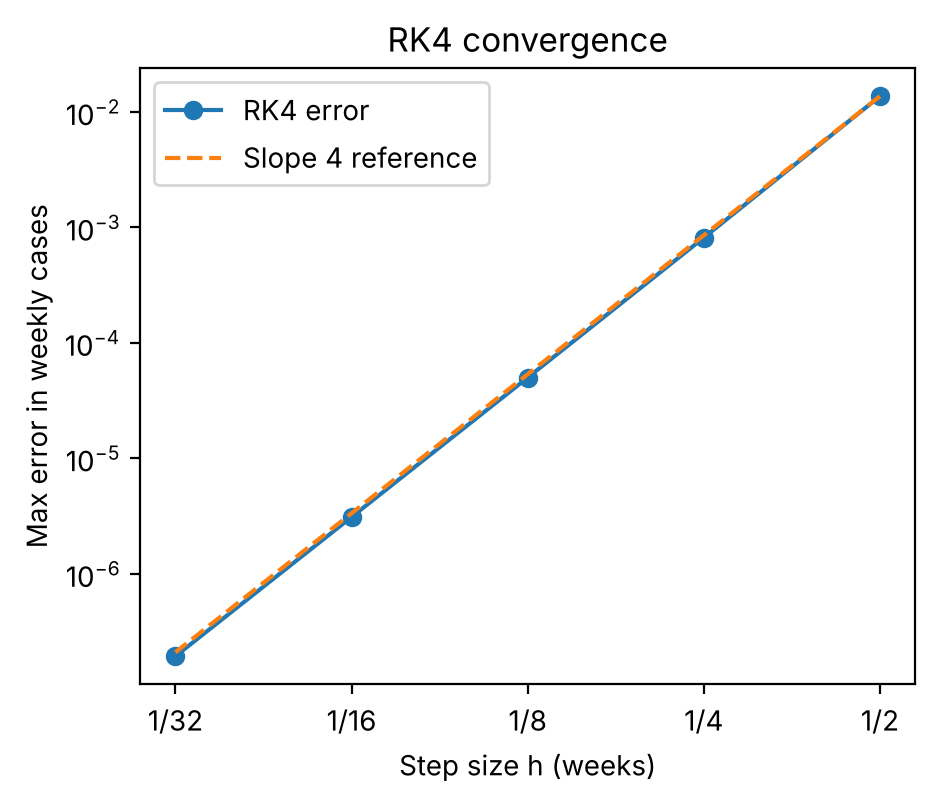

# Theory and mathematics

This page gives the model, the numerical methods and the checks behind the notebook. Equation numbers match the project report. Cell numbers refer to the notebook, counting the title as cell 1.

## 1. Problem formulation

Colombo district had its largest dengue epidemic on record in 2017, with a peak of 1,972 reported cases in the week of 15–21 July [3], [4]. The question is:

> If mosquito control had cut dengue transmission in Colombo by 20%, starting *k* weeks before the 2017 peak, how much lower would the peak have been, and when would it have come, with 95% credible intervals?

To answer it, a model is first fitted to what actually happened in weeks 12–42 of 2017 (31 weeks around the main wave), and then re-run with control switched on. The quantities of interest are:

- the **peak reduction**: how much lower the highest weekly case count is, in percent;
- the **peak shift**: how many weeks earlier or later the peak comes;
- the **cases averted**: the share of reported cases in weeks 12–42 that would not have happened;
- the **critical cut** c\*: the smallest sustained cut that stops the growth.

## 2. Assumptions

1. **One well-mixed population** of N = 2,480,000 people, the official 2017 mid-year estimate for Colombo district [5]. Local hot spots and movement are ignored.
2. **A fixed infectious period of 6.5 days**, so the recovery rate is γ = 7/6.5 per week [6]. Section 5 of the notebook refits the model at 5 and 8 days to test this.
3. **Mosquitoes are not modelled directly.** Their effect is folded into the transmission rate β(t), which is allowed one smooth drop during the season. This keeps the number of unknown parameters small enough to estimate from case counts alone [9].
4. **Every new infection is a reported case.** A constant background term *b* covers cases from outside the modelled chain of transmission.
5. **Control is a constant cut** in β(t) by a fraction *c* while it runs.

## 3. Model equations

Time *t* is in weeks of 2017. The population is split into susceptible *S*, infectious *I* and recovered *R* people, and *C* counts all infections since week 12 [8]:

$$
\frac{dS}{dt} = -\beta(t)\frac{SI}{N}, \qquad
\frac{dI}{dt} = \beta(t)\frac{SI}{N} - \gamma I, \qquad
\frac{dR}{dt} = \gamma I, \qquad
\frac{dC}{dt} = \beta(t)\frac{SI}{N} \qquad (1)
$$

Adding the first three equations gives d(S + I + R)/dt = 0, so the population is conserved. Transmission drops once during the season through a smooth logistic switch σ(x) = 1/(1 + e⁻ˣ):

$$
\beta(t) = \beta\left[1 - \delta\,\sigma\left(\frac{t-\tau}{w}\right)\right] \qquad (2)
$$

A sudden step would break RK4's fourth-order accuracy and make the likelihood jump whenever τ crossed a time step. With w = 0.5 week the switch is smooth, yet completes most of the change within about two weeks.

**Reproduction number and the critical cut.** Reported cases were only about 1.3% of the population, so S stays close to N and Eq. (1) gives dI/dt ≈ (β(t) − γ)I. Cases grow only when R(t) = β(t)/γ > 1. Before the drop R₀ = β/γ, and afterwards R₀(1 − δ). Mosquito control multiplies β(t) by a factor that switches on at week *a* and off at week *a* + *d*:

$$
\beta_c(t) = \beta(t)\left[1 - c\left(\sigma\left(\frac{t-a}{w}\right) - \sigma\left(\frac{t-a-d}{w}\right)\right)\right] \qquad (3)
$$

A sustained cut stops the growth when R₀(1 − c) < 1, which gives the critical cut:

$$
c^{*} = 1 - \frac{1}{R_0} \qquad (4)
$$

**Observation model.** The expected reported cases in week *j* are the new infections in that week plus the background:

$$
\mu_j = C(t_{j+1}) - C(t_j) + b \qquad (5)
$$

| Symbol | Meaning | Units | Value / range | Source |
|---|---|---|---|---|
| t | Time | weeks of 2017 | 12 to 43 | — |
| S, I, R | Susceptible, infectious and recovered people | people | S + I + R = N | [8] |
| C | Cumulative infections since week 12 | people | starts at 0 | — |
| N | Population of Colombo district | people | 2,480,000 (fixed) | [5] |
| γ | Recovery rate | per week | 7/6.5 ≈ 1.077 (fixed) | [6] |
| w | Width of the switch | weeks | 0.5 (fixed) | design choice |
| β | Transmission rate before the drop | per week | fitted, prior U(0.5, 3) | — |
| δ | Fractional drop in β | — | fitted, prior U(0, 0.95) | — |
| τ | Time of the drop | week of 2017 | fitted, prior U(20, 40) | — |
| I₀ | Infectious people at week 12 | people | fitted, prior U(1, 5000) | — |
| b | Background cases | cases per week | fitted, prior U(0, 1000) | — |
| k | Negative-binomial dispersion | — | fitted, prior U(1, 500) | [18] |
| c, a, d | Control strength, start week and length | —, week, weeks | scenario inputs | — |

The fitted values (posterior medians with 95% credible intervals) are β = 1.181 (1.164–1.200), δ = 0.532 (0.430–0.661), τ = 31.82 (31.21–32.42), I₀ = 238 (182–300), b = 189 (152–227) and k = 44.7 (24.5–76.3). These give R₀ = 1.096 (1.080–1.114) before the drop and 0.513 (0.373–0.622) after it.

## 4. Numerical method

### 4.1 Fourth-order Runge–Kutta

With β changing over time, Eq. (1) has no closed-form solution, so it is solved with the classical RK4 method [17]. For y = (S, I, R, C) and dy/dt = f(t, y), one step of size *h* is:

$$
\begin{aligned}
k_1 &= f(t_n, y_n), & k_2 &= f\left(t_n + \tfrac{h}{2},\ y_n + \tfrac{h}{2}k_1\right),\\
k_3 &= f\left(t_n + \tfrac{h}{2},\ y_n + \tfrac{h}{2}k_2\right), & k_4 &= f(t_n + h,\ y_n + h k_3),\\
y_{n+1} &= y_n + \tfrac{h}{6}\left(k_1 + 2k_2 + 2k_3 + k_4\right)
\end{aligned} \qquad (6)
$$

- **Accuracy.** The error of one step is O(h⁵) and the global error O(h⁴), so halving *h* cuts the error about 16 times. The notebook measures a slope of 4.03 (cell 16).
- **Stability.** RK4 is stable when hλ lies inside its stability region, which reaches about −2.79 on the negative real axis [17]. The fastest rate here is recovery, γ ≈ 1.08 per week, so even h = 0.25 gives hγ ≈ 0.27. Accuracy, not stability, sets the step size.
- **Step size.** Results use h = 0.1 week. The sampler uses h = 0.25 week, which is 2.5 times faster and changes the weekly cases by at most 0.004 (asserted in cell 11).
- **Vectorisation.** The state has shape (4, runs), so one call advances all 32 chains or all 2,000 posterior draws at once. This is 91 times faster than a Python loop on a laptop and 80 times faster in Colab (cell 32).

### 4.2 Likelihood and priors

Weekly counts vary far more than a Poisson model allows, so the observed cases yⱼ are modelled as negative binomial with mean μⱼ and dispersion *k*:

$$
P(y_j \mid \mu_j, k) = \frac{\Gamma(y_j + k)}{\Gamma(k)\, y_j!}\left(\frac{k}{k+\mu_j}\right)^{k}\left(\frac{\mu_j}{k+\mu_j}\right)^{y_j}, \qquad
\operatorname{Var}(y_j) = \mu_j + \frac{\mu_j^{2}}{k} \qquad (7)
$$

With k ≈ 45 the standard deviation at the peak is about 290 cases, against 44 for a Poisson model. The six parameters θ = (β, δ, τ, I₀, b, k) have the uniform priors in the table above, and the posterior is p(θ | y) ∝ p(θ) ∏ⱼ P(yⱼ | μⱼ(θ), k) over weeks 12–42 [18]. The likelihood is computed in log form with SciPy's log-gamma function, so factorials of counts near 2,000 do not overflow.

### 4.3 Random-walk Metropolis sampling

From the current point θ, a proposal θ′ = θ + ε with ε ~ N(0, Σ) is accepted with probability [14]:

$$
\alpha(\theta \to \theta') = \min\left(1,\ \frac{p(\theta' \mid y)}{p(\theta \mid y)}\right) \qquad (8)
$$

The symmetric proposal gives detailed balance, so the posterior is the stationary distribution of this Markov chain. A pilot run of 800 iterations estimates the posterior covariance, and the main run uses Σ = (2.38²/d) Σ_pilot with d = 6, the near-optimal scaling of Roberts *et al.* [16]. The measured acceptance rate, 26%, is close to the 23% this theory targets. 32 chains run 1,500 iterations each; after 500 burn-in iterations, 32,000 samples remain.

Convergence is checked with the Gelman–Rubin statistic, which compares the between-chain variance *B* with the within-chain variance *W* for chains of length *n* [15]:

$$
\hat{R} = \sqrt{\frac{\frac{n-1}{n}W + \frac{1}{n}B}{W}} \qquad (9)
$$

The largest R̂ is 1.018, below the usual threshold of 1.1.

### 4.4 Monte Carlo estimates

Every reported number is a Monte Carlo estimate from posterior samples θ⁽¹⁾, …, θ⁽ᴹ⁾:

$$
\mathbb{E}\left[g(\theta) \mid y\right] \approx \frac{1}{M}\sum_{m=1}^{M} g\left(\theta^{(m)}\right) \qquad (10)
$$

By the law of large numbers this converges to the posterior expectation as M grows. Medians and 95% credible intervals are sample percentiles. Each control scenario is run for 2,000 posterior draws, so the calibration uncertainty flows into every answer.

## 5. Verification

| Check | Expected | Obtained | Pass? |
|---|---|---|---|
| PASS 1: conservation, S + I + R = N | rounding error only | largest relative error 9.4 × 10⁻¹⁶ | yes |
| PASS 2: analytic relation S = S₀ exp(−R₀R/N) for constant β | agreement to solver accuracy | largest relative error 1.0 × 10⁻⁹ | yes |
| PASS 3: RK4 convergence order, with a control period switched on | slope 4 on a log–log plot | 4.03 | yes |
| PASS 4: limiting cases | R₀ < 1 dies out; a 0% cut equals the baseline | both hold | yes |
| PASS 5: recovery of known parameters from 31 weeks of synthetic data | all six true values inside their 95% CrIs | all six inside (e.g. β = 1.25 recovered as 1.254, CrI 1.228–1.283); R̂ ≤ 1.016 | yes |
| Posterior predictive check on the 2017 data | about 95% of weeks inside the 95% prediction interval | 30 of 31 weeks (97%); the outlier is the New Year dip in week 15 | yes |

PASS 1–4 are in cells 14–17 and PASS 5 in cell 19. Each is an `assert`, so *Run all* stops if any of them fails.

## 6. Concepts applied

| Concept | Where it is used in this project |
|---|---|
| Population and epidemic models (SIR), reproduction number | The model, Eqs. (1)–(4); the critical cut c\* = 8.8% (notebook sections 1–2) |
| Numerical ODE solvers (RK4), error order and stability | The self-written solver, Eq. (6), and the measured slope of 4.03 (cells 7 and 16) |
| Markov chain Monte Carlo and the Metropolis algorithm | Calibration with 32 tuned chains, Eq. (8) (cells 12 and 22) |
| Markov chains: stationary distribution, burn-in and convergence | Detailed balance, 500 burn-in iterations and the R̂ check, Eq. (9) (cells 12 and 23) |
| Monte Carlo integration and the law of large numbers | Every median and 95% credible interval, Eq. (10) (cells 26–30) |
| Input modelling and random variate generation | The negative-binomial noise model, Eq. (7), used for the synthetic test and the predictive check (cells 19 and 24) |
| Verification and validation | PASS 1–5 and the posterior predictive check (cells 14–19 and 24) |
| Sensitivity analysis | Sweeps of cut strength, start time, campaign length and infectious period (cells 26–30) |

## 7. References

Numbers in square brackets refer to [REFERENCES.md](REFERENCES.md).