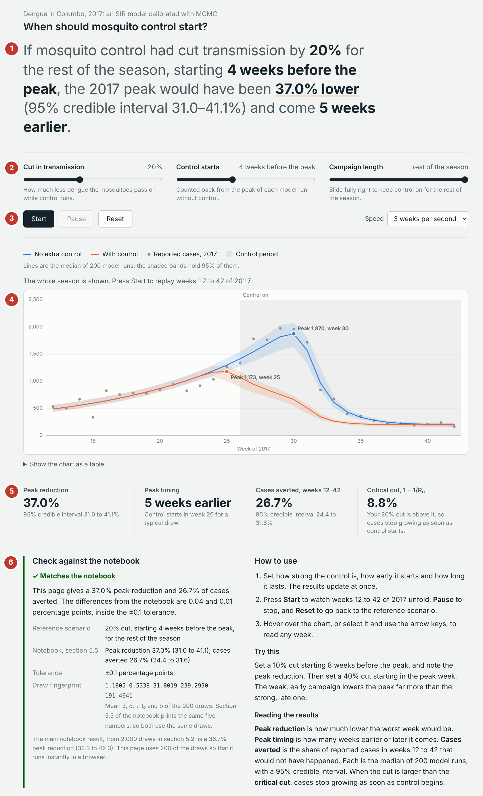

# User guide: dengue mosquito-control web demo

**Open the demo:** [https://geethsenaviratne.github.io/dengue-sir-mcmc-colombo/](https://geethsenaviratne.github.io/dengue-sir-mcmc-colombo/). It runs entirely in your browser (current Chrome, Edge or Firefox). Nothing is installed or uploaded.

**Offline:** download this repository and double-click `docs/index.html`.

The demo runs the notebook's SIR model and RK4 solver in JavaScript on 200 posterior draws from the MCMC calibration, so every result comes with a 95% credible interval. It answers the project's question: *how much lower, and when, would Colombo's 2017 dengue peak have been if mosquito control had cut transmission, starting some weeks before the peak?*

The numbers on the screenshot match the parts described below.

## Controls

| Control | What it does | Range | Default |
|---|---|---|---|
| (2) Cut in transmission | How much less dengue the mosquitoes pass on while control runs, in percent | 0–50%, in steps of 5% | 20% |
| (2) Control starts | How many weeks before the peak control begins. The peak is that of each model run without control | 0–10 weeks before the peak | 4 weeks |
| (2) Campaign length | How long control runs. Fully to the right keeps it on for the rest of the season | 1–20 weeks, or the rest of the season | rest of the season |
| (3) Start / Pause | Replays weeks 12 to 42 of 2017 week by week, or pauses the replay | — | — |
| (3) Reset | Stops the replay and restores the reference settings above | — | — |
| (3) Speed | How fast the replay runs | 1, 3 or 6 weeks per second | 3 weeks per second |

The results update as soon as a slider moves; you do not need to press Start.

## Reading the outputs

- **(1) Answer sentence:** the research question with the current settings and its answer, for example "the 2017 peak would have been 37.0% lower (95% credible interval 31.0–41.1%) and come 5 weeks earlier".
- **(4) Chart:** weekly cases in weeks 12–42 of 2017. Grey dots are the reported cases. The blue line is the model without extra control and the orange line the model with your control. Each line is the median of 200 model runs, and the shaded band around it holds 95% of them. The grey area marks when control is on. Hover over the chart, or select it and use the left and right arrow keys, to read any week. *Show the chart as a table* gives the same numbers as a table.
- **(5) Peak reduction:** how much lower the worst week would be, in percent, with its 95% credible interval.
- **(5) Peak timing:** how many weeks earlier or later the peak comes, and the week control starts for a typical draw.
- **(5) Cases averted, weeks 12–42:** the share of reported cases in that period that would not have happened, with its 95% credible interval.
- **(5) Critical cut, 1 − 1/R₀:** the smallest sustained cut that stops the growth (8.8%). When your cut is larger, cases stop growing as soon as control begins.

## Try this

1. Set a **10% cut** starting **8 weeks before the peak**, and note the peak reduction: about 53%, and the peak comes 9 weeks earlier.
2. Now set a **40% cut** starting **0 weeks before the peak** (in the peak week): the peak falls by only about 14%. A weak, early campaign does far more than a strong, late one.
3. Press **Reset**, then shorten the **campaign length** to 2 weeks. The peak reduction falls only slightly, from 37.0% to 33.5%, because transmission drops by itself in early August. The cases averted, however, fall from 26.7% to 15.6%.

## Check against the notebook

With the default settings, the demo should give **37.0% peak reduction (95% CrI 31.0–41.1%) and 26.7% of cases averted (24.4–31.6%), within ±0.1 percentage points**. These are the values that notebook section 5.5 computes from the same 200 draws. The **(6) Check against the notebook** panel shows ✓ when the two agree.

The panel also shows a *draw fingerprint*: the mean β, δ, τ, I₀ and b of the 200 draws (1.1805, 0.5338, 31.8019, 239.2930, 191.4641). Notebook section 5.5 prints the same five numbers, which shows both use identical draws.

The notebook's main result, from 2,000 draws in section 5.2, is a 36.7% peak reduction (32.3–42.3%). The demo shows 37.0% because it uses 200 of those draws so that it runs instantly in a browser.

## Limitations

- The demo cannot refit the model, so the 2017 data, the population and the 6.5-day infectious period are fixed.
- With 200 draws its credible intervals are slightly rougher than the notebook's.
- As in the notebook, the start of control is counted back from each run's own peak, which is only known with hindsight.